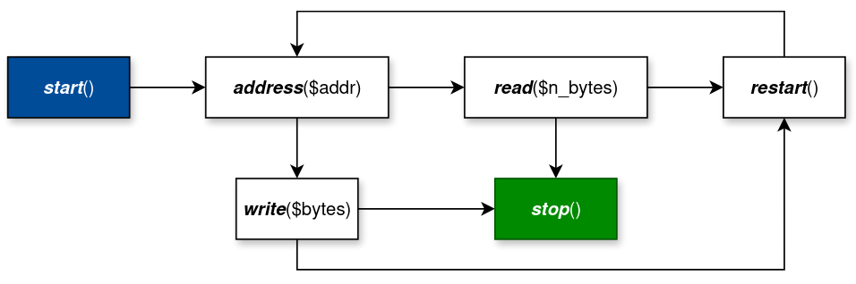

# I2C API

Abstract Python classes for I2C master devices (normally dongles such I2CDriver etc.) to communicate with I2C slaves.

I2C is a simple 2-wire (SDA and SCL lines) protocol commonly used to communicate with environmental sensors, motor and
pwm controllers and so on. Multiple devices can be connected on the same I2C bus. One of which is a master/controller
device
and others are slave/client devices. Multiple master devices can also be connected on the same bus but managing that
particular use case is outside the scope of this library. Master always is the one who drives the clock line (CLK),
while master and a target slave take turns driving the data (SDA) line. Whichever device drives data line for every
byte sent recipient device sends ACK or NACK bit at the end of each byte. Each exchange is known as transaction.
And each transaction starts with start condition (`S` in official documentation) and ends with stop
condition (`P` in official documentation) driven by the master. From standpoint of
view of the master transaction consist of mixture of one or more of read or write operations (blocks). If a single
transaction has more than one block, blocks are separated by the restart condition (`Sr` in on official documentation).
In [EBNF](https://en.wikipedia.org/wiki/Extended_Backus%E2%80%93Naur_form) notation it can be written like so

```ebnf
S           = start_condition;
Sr          = restart;
P           = stop_condition;
transaction = S block {Sr block} P;
```

Both read and
write ops are initiated by the master. Master writes 7 bits target slave address following by a bit which indicates
that this is a read or write
operation. If operation is "read", then master stops driving the data line and then the target slave drives data line in
response. If master keep driving the clock and does not issue a stop condition slave must keep sending bytes back.
If operation is "write", then master continues driving the data line sending as many bytes as necessary. After
completing read or write part master can issue the stop condition and thus and transaction, or it could issue restart
condition followed by read or write part.

```ebnf
block       = read_block | write_bloc;
read_block  = slave_address_7bits read_bit slave_address [byte_from_slave];
write_block = slave_address_7bits write_bit slave_address [byte_to_slave];
```

Notice, that nowhere above we talked about reading or writing registers.
Common way to define register write is simply to send `write($device_address)` followed by write bit and
then `write($register_address)` and then by `write($register_value)`. Register read operation consist of "write"
part to the device (`write($device_address)`) followed by write bit, then `write($register_addres)` and then
stop followed by a start condition or just a restart condition, then `write($device_address)` followed by a read bit,
then read bytes from the slave device. If, for example register value is 16 bits, then write first byte and then
second byte.

This library provides three forms of communicating to the slave/controller device. Low level, using something called
_I2C
Language_, a more traditional methods `I2CMaster::read(...)` and `I2CMaster::write(...)` and registers read/write
methods. Let's take a look at them in order.

## I2C Language



## Read/Write ops

## Register read/write ops